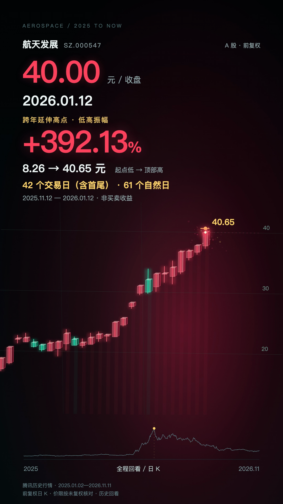
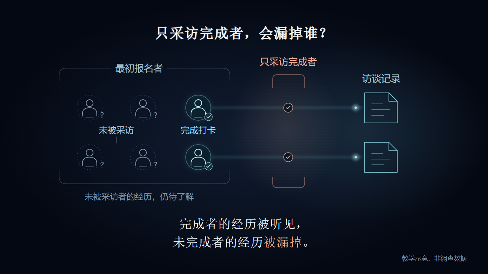

# 科普与股票动画制作工作区

仓库包含原有Windows/HyperFrames科普工程，以及新加入的Remotion股票行情动画。各项目独立保留源码、资料与制作记录。

## 最新：航天发展日K动画

30秒、1080×1920、30fps；2025-01-02—2026-11-11，重点展示商业航天题材主升、连板与分歧、两次顶部统计和后续回撤。

[](previews/stock-video/aerospace-development-2025-now-v1.mp4)

- [观看MP4](previews/stock-video/aerospace-development-2025-now-v1.mp4)
- [股票工程与运行方式](projects/stock-video/README.md)
- [完整制作细节](docs/stock-video/PRODUCTION_DETAILS.md)：K线材质、数据驱动运镜、停顿、电子音效、文案、消息与峰值算法
- [换股工作流](projects/stock-video/docs/STOCK-VIDEO-PLAYBOOK.md)、[航天发展资料摘要](projects/stock-video/projects/aerospace-2025/research/summary.md)
- [stock-video Skill](.agents/skills/stock-video/SKILL.md)、[发布记录](docs/stock-video/RELEASE.md)

```sh
cd projects/stock-video
npm ci
npm run check:aerospace
npm run dev
```

首次安装使用npm ci，后续按README重建和渲染。Node、Python、FFmpeg优先复用已有环境；依赖固定版本。Mac制作与发布检查已完成，Windows兼容入口和字体回退未作实机验收。

---

# 幸存者偏差项目（原有HyperFrames工程）

以“幸存者偏差”为案例，记录从科学资料核查、知识稿审核、逐页脚本、静态样张到HyperFrames动画与运镜修订的全过程。当前成果为30秒、1280×720、30fps的本地动画；本仓库保存审核后的项目源码与文档。



## 阅读入口
- [完整项目总结](docs/PROJECT_SUMMARY.md)
- [已审核科普知识稿与来源](docs/knowledge/KNOWLEDGE.md)
- [逐页演示/剪辑稿](docs/planning/SCRIPT_V3.md)
- [参考风格分析](docs/planning/REFERENCE_STYLE.md)
- [动效与运镜导演方案](docs/planning/MOTION_DIRECTION.md)
- [制作流程](docs/WORKFLOW.md)、[版本记录](docs/CHANGELOG.md)、[检查结果](docs/QA.md)
- [GitHub提交审核清单](SUBMISSION_REVIEW.md)

## 代码结构
```text
projects/survivorship-bias/    最新连续运镜工程
  index.html                 场景、音乐和效果音挂载
  compositions/journey.html   SVG世界、固定文案层与GSAP时间轴
  build_motion.py            模板生成器
  drawing.py                 矢量绘图辅助函数
  camera-keyframes.json      相机矩阵与时间
  assets/vector-definitions.svg
  local-assets.example.json  本地依赖校验清单
scripts/                     本地素材导入及提交包验证
.agents/skills/science-video/ 科普制作流程约定
previews/                    本项目代码绘制画面的预览
```

## 本地运行
需要Node、Python、Chrome与FFmpeg。原制作版本见[环境记录](docs/ENVIRONMENT.md)。
先按[素材恢复说明](docs/ASSETS.md)恢复本地依赖；没有这些文件不能直接渲染。然后：

```powershell
cd projects/survivorship-bias
npm run dev
npm run check
npm run render
```

渲染命令固定HyperFrames 0.9.23，输出render-raw.mp4。若CLI尚未安装，npx需要网络下载依赖；已有缓存时可使用npx --offline hyperframes@0.9.23。
本项目没有付费模型调用，不包含生图照片。背景音乐与效果音的复用范围、来源见[依赖记录](docs/THIRD_PARTY_NOTICES.md)。

## 当前边界
知识稿、静态风格和30秒制作分别取得过用户确认；提交范围以用户最新明确授权为准；该段为原项目审核历史。90秒完整知识版尚未制作。声音做过信号测量，未人工试听；用户的最终观看评价仍需保留。
