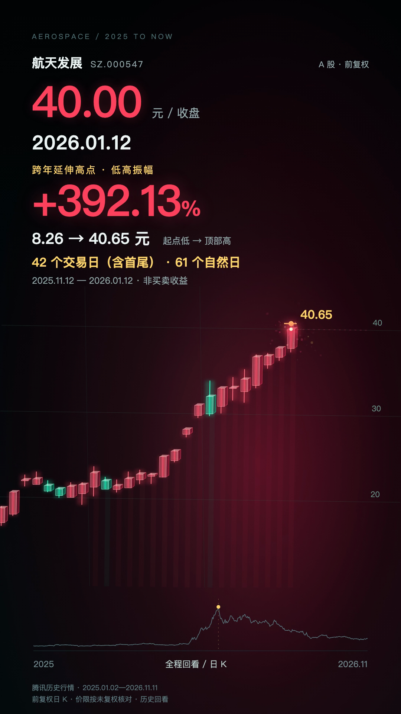

# 股票行情视频：制作细节与复用约定

## 平潭发展V3补充：120秒破位与声音设计

最新独立实现是`StockTechVideo.tsx`、`StockTechEffects.tsx`和`build_pingtan_v3.py`，配置、285行行情和3600帧计划位于`pingtan-2025-v3`；V1/V2及本文件原有航天发展规则保留。5个上行高点与4个下行低点暂停完整K线、全局框选后回到局部；最终16.86高点保留11.6秒，展示价格、量和换手。

上破玻璃碎片上扬，下破采用更大片的下坠多边形、重力、厚边折射、冲击波及暗角；连续失守支撑时重复触发，不只在上涨时使用。闪电带粗亮主干、多级分叉、火花和命中环，端点绑定对应事件蜡烛最低影线。科技框由角标、发光节点、扫描网格、测距线和价格胶囊组成；下跌框统一从16.86顶部测量至阶段盘中低点，显示负幅度、交易日和跌停数。红绿K线保留真实OHLC，材质增加透明侧面、内反光和外发光。

声音采用免费真实素材，涨停先充能再释放，破位叠加玻璃、重击和低频。先测素材实际能量峰再裁入事件，避免较长音效文件在开头没有主体冲击；音乐连续120秒保持原动态，最终固定0.7倍总输出，只对音效贡献做余量约束。声音落点波形不能替代人工试听。源码、9个统计节点、音效来源、试听位置、检查范围和旧版本标签见[平潭发展发布记录](PINGTAN_RELEASE_2026-11-12.md)。

## 先前模块：航天发展与通用基础

本次更新把Mac上制作的股票动画整合进现有science-video-studio，独立工程位于`projects/stock-video/`，保留原有`projects/survivorship-bias/`的HyperFrames代码、资料和流程。最新样片为航天发展000547，30秒、1080×1920、30fps；历史范围2025-01-02—2026-11-11，重点是2025年11月启动的商业航天题材行情。

[观看航天发展成片](../../previews/stock-video/aerospace-development-2025-now-v1.mp4)

## 必须继承的视觉修改

- 主图使用真实开高低收蜡烛：实体和上下影线均保留，红涨绿跌，不再以发光收盘折线代替K线。底部缩略线只负责全程定位。
- 蜡烛由半透明正面、侧面、顶面高光、背面细线和窄反光组成，保持玻璃立体感；柔光、粒子和落点环不改变OHLC数值。
- HUD、日期、报价和消息固定在屏幕层，图表在数据空间内移动。平稳阶段也按近期区间放大，急涨急跌才加强推近、跟随、侧倾和短震动。
- 关键K线迅速连续长完，然后停在完整形态，下一根稍后才开始。用户要的慢放是“完整K线之间的停顿”，不是中途卡住蜡烛伸展。
- 主升扩张加强红色背景，急跌加强绿色背景。镜头和背景依据已发生价格变化，时间压缩只改变叙事节奏。
- 删除“近景”“快速下压”等制作词与“近5个交易日+25%”重复面板；屏幕使用经核验的市场语言、短句与消息。

完整系列约定见[换股工作流](../../projects/stock-video/docs/STOCK-VIDEO-PLAYBOOK.md)，长期入口为[stock-video Skill](../../.agents/skills/stock-video/SKILL.md)。

## 从资料到对应K线

每只股票先写研究摘要，再生产画面。摘要含证券代码/公司身份、数据截止、复权口径、主升起点与顶部选择、消息公开时间、论坛解读、术语证据准入表和未证实事项。新股票重新研究，不能把前股的新闻、标签、监管条件沿用过去。

行情事实、官方政策、公司公告和论坛解读分开记录。11月25日公开的政策不能用11月18日落款倒置解释11月14日首板；产业政策也不等于该股订单或利润。论坛“卡异动”可作为注明来源的市场观点，不能据此确认操盘意图。日线可证明特殊T字回封和收盘未封住，不能提供炸板次数、封单厚度、资金自然人身份或流动性枯竭。

航天发展证据入口：[研究摘要与来源](../../projects/stock-video/projects/aerospace-2025/research/summary.md)、[原始行情请求清单](../../projects/stock-video/projects/aerospace-2025/research/data-sources.json)、[通用术语证据表](../../.agents/skills/stock-video/references/market-language.md)。其中核对了缩量一字、5连板T字回封、断板跌停、12天8板、炸板回落、卡异动观点与严重异动公告。

## 图形、镜头与形状插值

共用渲染器`src/StockMotionVideo.tsx`读取配置生成的film JSON。股票名称、代码、日期、事件、消息和顶部统计均为数据，不在渲染器中另写一只股票。

基础坐标为`x = 交易日索引 × 6`、`y = −价格 × 28`。屏幕应用sx/sy、平移及轻微侧倾；二维坐标变换形成连续推近、跟随与全景拉回，不依赖Blender。相邻帧对相机目标做阻尼插值，蜡烛正面/侧面/顶面的SVG顶点同样随开高低收插值。

当前相机power取近期涨跌幅与大幅日变动的强度。lookback约为`round(36−19×power)`；水平目标跨度900px，垂直目标跨度605px，局部价格跨度至少为`max(0.45, 当前价×6%)`。常规阻尼0.21，长停留时降到0.08，最后落稳；侧倾限制约±1.65°。当前蜡烛完整高低价被限制在图表安全区，所有正常跟随帧进行边界检查。

落点震动随完成帧触发，使用`exp(−距落点帧数/3.4)`衰减，13帧后结束。峰值增强冲击，文字不随之震动。结尾约44帧平滑拉回全部历史；主图和视频时间都经过变速压缩，不能跨段用画面斜率比较收益速度。

## 停顿与时间分配

30fps下，关键蜡烛生长2帧，缓动为`1−(1−min(1, local/2))³`，之后保持完整形态。HUD与文字只读取settledIndex，蜡烛未完成时不提前标下一交易日收盘或连板数。

本片449条日线压缩为155个可见时间段、27个关键声音落点。重点范围逐日呈现，普通历史阶段加速；结尾仍展示全部日线。生成器在帧预算内分配普通停顿与里程碑额外停顿，而不是随机按视频秒数晃动。

|帧区间（含首、不含尾）|大致秒数|内容|
|---|---|---|
|0—36|0—1.20|标题引入|
|36—113|1.20—3.77|2025年前期铺垫|
|113—246|3.77—8.20|启动、缩量一字、T字回封、断板|
|246—345|8.20—11.50|政策背景、12天8板、炸板|
|345—454|11.50—15.13|阶段分歧与再蓄势|
|454—514|15.13—17.13|卡异动复盘观点、跨年延伸|
|514—575|17.13—19.17|2025年高点与统计卡|
|575—621|19.17—20.70|跨年延伸|
|621—688|20.70—22.93|区间顶部与统计卡|
|688—735|22.93—24.50|严重异动提示与高位跌停|
|735—810|24.50—27.00|后续回撤至最新完整日线|
|810—900|27.00—30.00|全局收束|

逐段精确日期、开始帧、完成帧、结束帧、文字与消息见[timeline.csv](../../projects/stock-video/projects/aerospace-2025/timeline.csv)。2025年峰值完成后保持59帧，跨年顶部保持65帧，给指标阅读时间。

## 涨幅与天数如何算

本轮起点定义为11月14日主升首板前最近的五日局部低点，2025-11-12最低8.26元；前后各两交易日低点均更高。不是直接选全年最低点。

|顶部|起点低价→顶部最高价|低高振幅|交易日（含首尾）|相隔自然日|
|---|---|---:|---:|---:|
|2025-12-30|8.26→33.88|310.1695%|35|48|
|2026-01-12|8.26→40.65|392.1308%|42|61|

低高振幅=`(最高价/起点最低价−1)×100%`；自然日是日期相减；交易日是该股日线记录数。该统计不是实际可实现收益。2025年度高点与2026年延伸高点分开显示，避免提前透露后续顶部。计算与回归断言见wave-stats.json、research/audit.py。

## 电子提示音与卡点

不复用参考片声轨。当前音轨由标准库合成，48kHz双声道：金属FM瞬态、数字双提示、紧低频三层叠加。普通上涨载频1320Hz、下跌660Hz，峰值1760Hz且冲击增强。提示音在蜡烛完成帧触发，之前45ms有短预备声；每次落点背景最低降到18%，约360ms恢复，增强相对辨识度。

归一化目标−15 LUFS、真峰值−1.2dBTP；强瞬态受峰值约束，实测WAV为−19.1 LUFS/−1.1dBFS，最终AAC为−19.2 LUFS/−0.4dBFS，无数字削波。技术测量不等同主观试听，本次没有声称完成人工听感验收。

未来提供音乐时：先确认素材使用范围、选段和节拍，标出重拍与乐句；保持交易日顺序，通过调整各段帧预算与完成后的停留，把重要封板、断板和顶部落在重拍上。用户指定音效点写入同一事件时间轴；不按音乐节拍改真实OHLC。

## Agent入口与工程复用

仓库根目录的AGENTS.md按任务路由至stock-video或原science-video流程；stock-video Skill本体只保留步骤，制作规范和术语字典在references按需读取。Codex在仓库范围内读取`.agents/skills/stock-video/`；复制到个人Skills目录可在其他工作区使用。

这次制作由单个Codex代理完成，未宣称运行多个专职Agent。以后有明确并行授权时，资料核验、脚本/分镜、图形实现与质检可分工，但共同使用同一brief、来源账本和时间轴，交付前汇合核验。原幸存者偏差项目的角色与审核约定保留在原文档，不作为本次实际执行记录。

## 版本、素材和验收

浙江世宝早期原型及V2—V5源码保留；新股票通过brief/daily/summary复用组件。成片命名保留股票、区间和版本，后续修改从源码继续，不从MP4重建。

公开包含源码、行情快照、研究摘要、计算结果、时间轴、原创合成后的音轨和航天发展成片。原始混音、下载的参考视频、参考抽帧、完整第三方检索页、字体、node_modules、浏览器缓存和凭据保持在本地。历史单发提示音的公开兼容文件从本次原创音轨128帧落点截取0.34秒，未上传来源记录不全的旧本地单发文件。

原始成片验收见[QA.md](../../projects/stock-video/projects/aerospace-2025/QA.md)。发布包另核对可重建性、跨平台入口、源码/成片哈希和Git提交范围；Windows启动分支和系统字体效果尚未在Windows上实际执行，不将Mac测试写成Windows实测。
