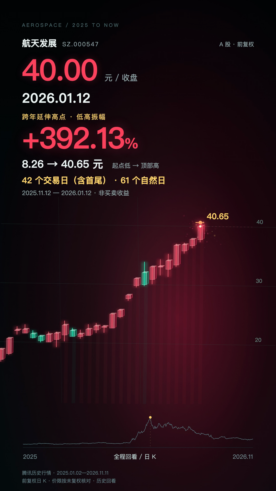

# 股票行情动画工程

Remotion 4.0.541 + React，真实日K、透明立体蜡烛、波动驱动镜头、完成后停顿、消息卡、顶部统计与原创电子音效。当前包含航天发展2025年至今的30秒样片，以及浙江世宝历次可编辑版本。

[](../../previews/stock-video/aerospace-development-2025-now-v1.mp4)

## 快速运行

先检查已有环境：Node满足package.json的engines、npm、Git、Python 3、FFmpeg；刷新行情还需curl。已有软件直接复用。依赖来自Remotion/React等已锁定npm包，没有为这次更新增加新的npm依赖。

在仓库根目录进入工程（PowerShell与Mac终端相同）：

```sh
cd projects/stock-video
npm ci
npm run check:aerospace
npm run dev
```

仅首次安装或锁文件变化后需要npm ci。选`Aerospace2025`，预览端口以Studio实际输出为准。所有已发布音轨和生成后的film JSON已随源码提供，可直接预览。中文系统字体按PingFang SC、Microsoft YaHei、Noto Sans CJK SC顺序回退，字体文件不打包。

修改资料或配置后重建并渲染：

```sh
npm run rebuild:aerospace
npm run check:aerospace
npm run render:aerospace
```

npm脚本通过run-python.mjs选择Mac的python3、Windows的py -3或python，启用UTF-8。Windows需要FFmpeg在PATH中；实际Mac生成与发布检查通过，Windows分支为兼容实现，尚未在Windows实机验收。渲染浏览器使用Remotion自带下载机制，不指定机器上的其他浏览器。

输出`out/aerospace-development-2025-now-v1.mp4`；out与原始混音保持Git忽略。发布的固定成片在仓库`previews/stock-video/`，不会被普通重渲染覆盖。

## 文件入口

- [制作细节：形态、镜头、停顿、声音、文案、消息、顶部算法](../../docs/stock-video/PRODUCTION_DETAILS.md)
- [换股工作流](docs/STOCK-VIDEO-PLAYBOOK.md)
- [航天发展研究摘要](projects/aerospace-2025/research/summary.md)
- [航天发展配置](projects/aerospace-2025/brief.json)、[时间轴](projects/aerospace-2025/timeline.csv)、[原始验收](projects/aerospace-2025/QA.md)
- `src/StockMotionVideo.tsx`：通用图表/相机/HUD/消息/统计卡
- `scripts/stock_video/build.py`：数据核验、时序、相机、电子音轨与逐帧检查
- `scripts/stock_video/fetch.py`：按股票、起止日获取腾讯固定快照并复用缓存
- [stock-video Skill](../../.agents/skills/stock-video/SKILL.md)

## 换股票

新建`projects/<股票-范围>/`，先完成资料摘要；准备日线、未复权日线/昨收、消息公开时间、术语证据、主升起点与顶部。复制并修改brief后运行生成器，在Root.tsx增加独立Composition并复用StockMotionVideo。股票的价限制度、除权和特殊交易日需要重新核对，不能只替换名称。

抓取固定快照的示例（在工程目录运行）：

```sh
node scripts/stock_video/run-python.mjs scripts/stock_video/fetch.py --symbol sz000547 --from 2025-01-01 --to 2026-11-11 --project projects/aerospace-2025
node scripts/stock_video/run-python.mjs scripts/stock_video/build.py projects/aerospace-2025/brief.json
```

先改symbol、目录和日期以创建新股票；已有原始快照默认复用，只有明确要更新时加--refresh。检查实际返回截止日，不把请求日期直接当作最新完整日线。

## 历史版本

浙江世宝V2为连续价格空间与霓虹效果，V3改为主图真实蜡烛，V4加入玻璃感与完成后停顿，V5加入连板和消息证据。详见docs/SHIBAO-V2—V5文档；各Composition独立保留。更早原型只是历史探索，当前系列规范以stock-video Skill为准。

保留前复权显示与未复权涨停判断的区别；截图斜率经过相机与历史时间压缩，不能直接当作实际涨速或可实现收益。原始行情与公开来源见每股研究目录。
